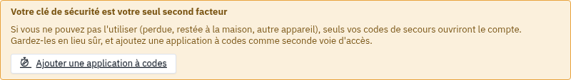
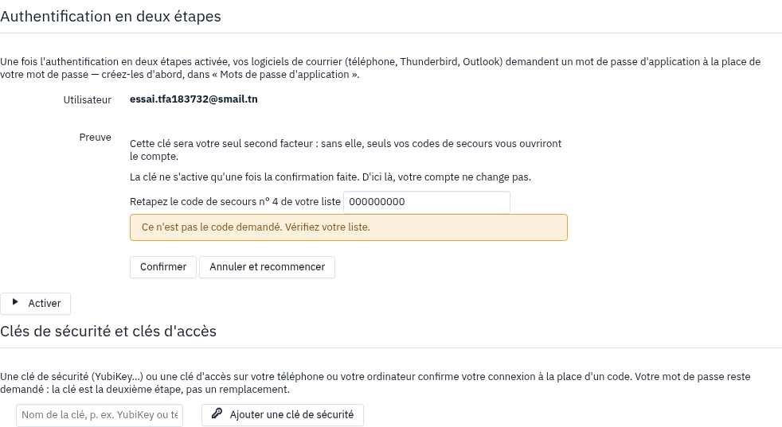
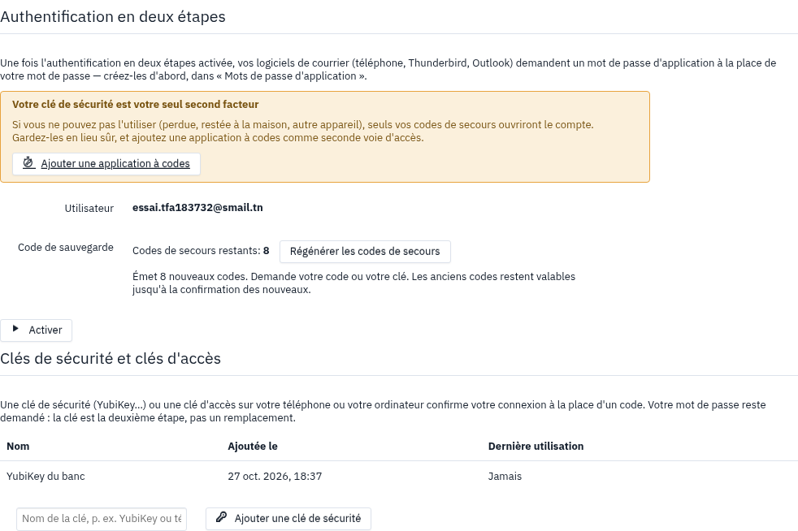
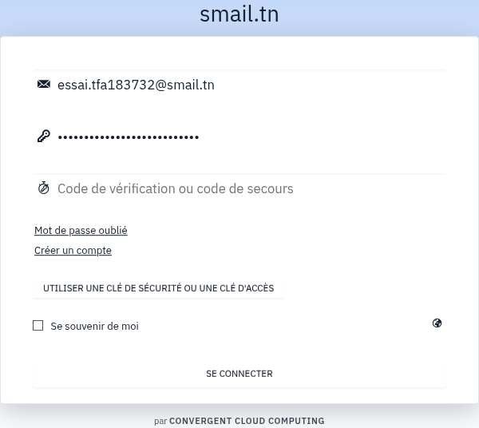
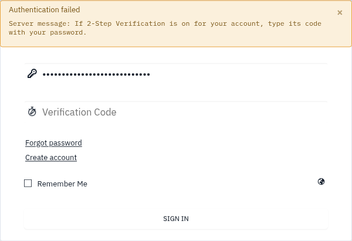

# Two Factor Authentication (two-factor-auth)

A second factor for SnappyMail logins: a **TOTP** code (any authenticator app),
**backup codes**, and since 2.28.0 **security keys and passkeys (WebAuthn)**.
Captures and how they are made: [`docs/captures/`](docs/captures/README.md).

## A key alone must not lock a person out (2.32.0)

A security key is bound to one device or one password manager. On another
device it is simply not there, and an account whose only second factor is that
key is then opened by its eight backup codes or by nothing. On 27 October 2026
a real account was locked this way: key registered in the morning, backup codes
shown once and not kept, no authenticator app. It had to be reset on the
server. 2.32.0 closes that, without weakening anything:

* **Registering a first key while no authenticator app is on** puts the key
  aside, with eight new backup codes. The screen says: *"This key will be your
  only second factor: without it, only your backup codes will open your
  account."* The key is active only after a **proof that the codes are kept**:
  "I have saved them" removes the codes from the screen, then the person
  retypes the code **whose rank the server chose** (`PendingAsk`).
  Until then nothing changes for the account: no second factor is on, the login
  is as before, and nobody is locked out. Cancelling starts again.
* **Settings**: a permanent warning while the key is the only second factor,
  with "Add an authenticator app"; the number of backup codes left; and
  **"Regenerate backup codes"**, which asks for a current code or key and keeps
  the old codes valid until one of the new ones has been retyped.
* **Login screen** (nothing about an account is shown before the password):
  the code field reads "Verification code or backup code" and, when keys are
  on, the key button is there, for every visitor. Every refusal of the
  credentials adds the same reminder (code, backup code or key), whatever the
  cause; the refusal itself is the core's own, identical for all accounts.

Design notes: [`TODO.md`](TODO.md), section 2.32.0.

## Security keys are a second factor, not a password replacement

SnappyMail opens the mailbox over IMAP **with the person's password**. A
passkey proves who is at the keyboard; it does not give the server that
password. Logging in with a passkey alone would need the server to keep every
password, or a master credential able to open any mailbox — both refused by
design. So the password comes first, then the code or the key.

## The code is checked before the password (2.30.0)

Every wrong password the webmail sends to IMAP is a failure counted by the
directory's password policy, which slows and then locks the account: whoever
knows an address could lock its owner out. For an account whose TOTP is on,
the code is now judged **before** the password leaves the webmail
(`filter.account`, right after `login.credentials`). Without the right code,
nothing reaches IMAP or the directory, nothing is counted, and the password
cannot be guessed through the webmail.

What this would open, and how it is closed:

* **Who has a second factor must not show.** The refusal is the core's own for
  a wrong password (`AuthError`, no additional message, the core's auth-log
  line read by fail2ban) and lasts as long (`precheck_delay`, 3 s — Cyrus'
  `failedloginpause`). The reminder "type the code with your password" is
  decided by the browser from the empty field alone, for every account.
* **No lockout anyone can trigger.** A wrong code before the password is not
  counted toward the record's lockout, and is judged without taking the
  record's lock or writing it. The limit is per IP (fail2ban). Each right code
  lets one password through once (its time step is spent): guessing the
  password now costs some 330 000 guessed codes per try.
* **Security keys** too, since 2.31.0. The login screen offers "Use a
  security key" from the start, wherever keys are on, to every visitor. The
  button asks `WebAuthnLoginOptions` for the typed address. The answer is the
  same for every address: an address without a key gets decoy credential ids,
  derived from it, stable, and 64 bytes long. The challenge is **stateless**
  (random bytes, an expiry, and a MAC over the address and the browser's
  connection token): nothing is written until a key signs it, so a flood of
  requests cannot push the owner's challenges out. The assertion is then
  judged before the password, written only on success, and its challenge is
  marked spent, which stops the replay of a passkey that has no counter.
* **Not covered:** IMAP and SMTP clients, which reach the directory directly
  (app passwords and the directory's slowdown guard them).

Proved on banc-smail:
* `BANC=avant`: three refusals, 0 failures counted by the directory; the
  control (right code, wrong password) counts exactly one;
* `BANC=cle`: two logins without a factor, 0 failures counted, then the key
  logs in.

## Settings (admin panel → plugin)

| Setting | Default | |
|---|---|---|
| `force_two_factor_auth`, `force_two_factor_domains` | off, empty | everyone / these domains must set up a second factor (held by the server since 2.27.0) |
| `precheck_delay` | 3 | seconds a refusal before the password waits (0–10), as long as a wrong password |
| `webauthn_enabled` | off | security keys and passkeys |
| `webauthn_origins` | empty | the webmail origins, e.g. `https://webmail.example.com`; empty = keys off. The Host header is never trusted |
| `webauthn_rp_id` | host of the first origin | the domain keys are bound to; changing it voids every key |
| `webauthn_require_uv` | off | require a PIN or biometrics on the key |
| `webauthn_max_passkeys` | 10 | per account (1–50) |
| `webauthn_challenge_ttl` | 300 | seconds (30–3600); each challenge is used once |
| `webauthn_counter_regression` | refuse | `refuse` or `warn` when a key's signature counter goes back |

Verified on the server, without any third-party library
(`providers/webauthn.php`): ES256, RS256 (2048–4096 bits), EdDSA (Ed25519, with
sodium); attestation `none` and `packed` (the chain is not trusted, the
statement must verify); strict, bounded CBOR. Keys are stored in the account's
record, sealed with a key derived from `APP_SALT`.

## Tests

    php plugins/two-factor-auth/tests/WebAuthnTest.php   # the verifier, real authenticator vectors
    php plugins/two-factor-auth/tests/ActionsTest.php    # the plugin's actions
    php plugins/two-factor-auth/tests/RecordTest.php     # the stored record
    node --test plugins/two-factor-auth/tests/*.test.js  # the browser code, in node:vm
    BANC=cle sh plugins/two-factor-auth/tests/browser/preparer.sh   # banc-smail, CDP virtual authenticator
    BANC=avant sh plugins/two-factor-auth/tests/browser/preparer.sh # banc-smail, the directory's failure count

## Deploying (2.32.0, same steps as 2.31.0 — written, not run)

Nothing is deployed by the commit. For each webmail, in this order:

1. Back up, outside the docroot: `command cp -a <plugins>/two-factor-auth /var/backups/<vhost>/plugins/two-factor-auth.bak-$(date +%Y%m%d-%H%M%S)`
   (`<plugins>` = `/var/www/vhosts/fastmail.convergent.tn/htdocs/data/_data_/_default_/plugins`,
   or `/var/www/vhosts/webmail.smail.tn/htdocs/data/_data_/_default_/plugins`).
2. Copy the plugin folder **without** `tests/` and `docs/`, with `command cp -r`
   (`cp` is aliased `-i` and silently copies nothing).
3. **Immediately** `restorecon -R <plugins>/two-factor-auth`: one request between the
   copy and `restorecon` makes SnappyMail drop the plugin from `enabled_list`.
4. `chown -R apache:apache`, files `644`.
5. Check through Apache: `curl -H 'Host: <vhost>' http://127.0.0.1:8888/?/Plugins/0/ | grep -c ConfirmBackupCodes`
   (the bundle must contain it), and `version` 2.32.0 in `index.php`.
6. Re-read `enabled_list` in `configs/application.ini`: `two-factor-auth` is still in it.
7. Empty the cache: **fastmail** `systemctl restart php-fpm` (APCu);
   **smail** delete the folders of `data/_data_/_default_/cache/` (files; restarting php-fpm clears nothing there), then grep `/?/Plugins/0/` again.
8. Nothing to configure: no new setting. `webauthn_*` stay as they are.
9. A device keeps the old bundle for up to an hour (`Expires` +1 h): test in a private window.
10. Roll back: put the backup folder back, `restorecon -R`, `chown`, same cache step.

