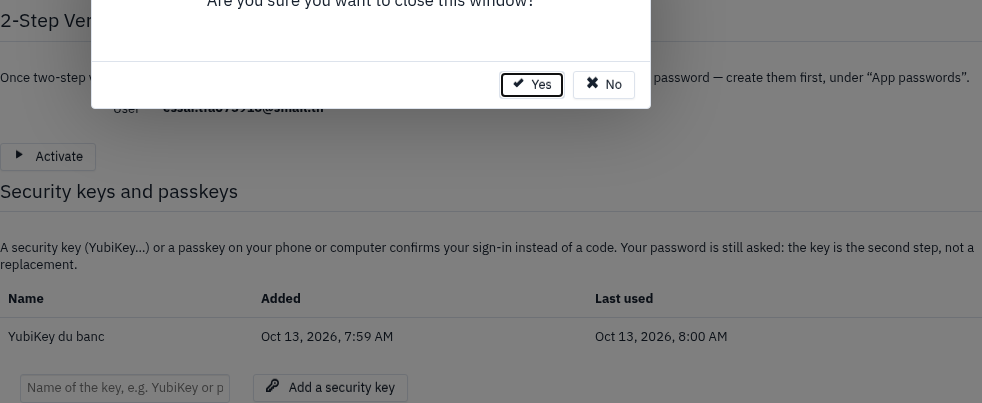
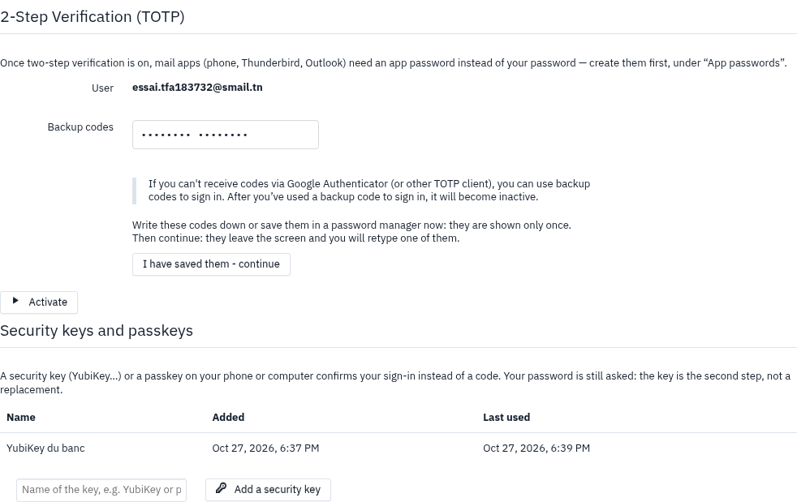
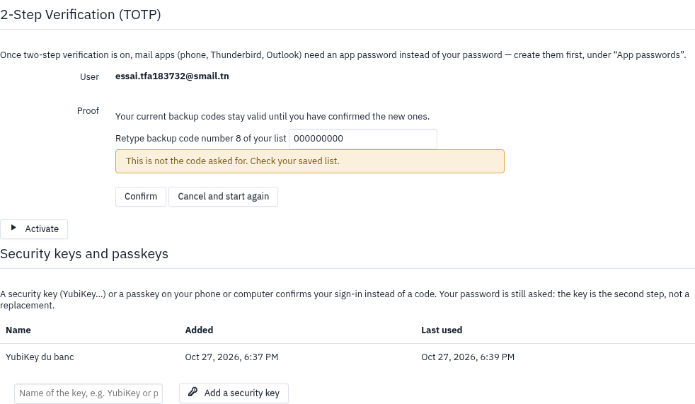
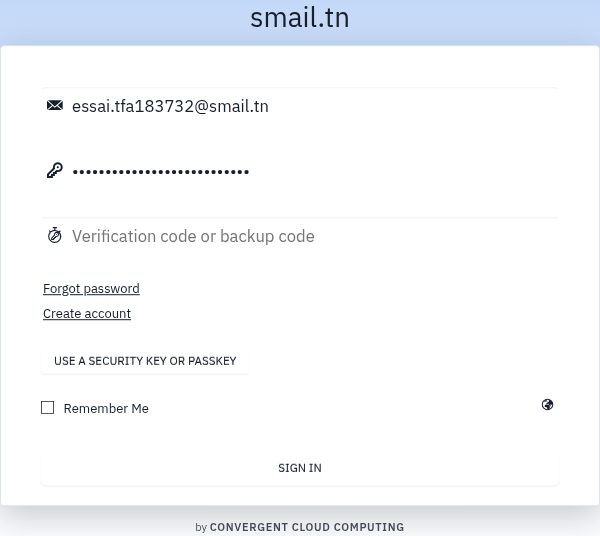
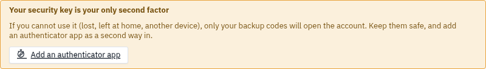

# User guide — 2-step verification

2-step verification protects your account even if someone learns your password: at sign-in, the webmail
also asks for a code from your phone, or for your security key. Everything is set in **Settings**, tab
**2-Step Verification (TOTP)**.

## Turn on verification with an authenticator app

**What it is for:** ask, at every sign-in, for a six-digit code that only your app knows (Google
Authenticator, Microsoft Authenticator, FreeOTP…).

1. Install an authenticator app on your phone.
2. In the webmail, open **Settings**, then **2-Step Verification (TOTP)**.
3. Click **Create a secret**. A QR code appears.
4. In the phone app, add an account by scanning the QR code.
5. Click **test**, then type the code the app shows.
6. Write down your **backup codes** and keep them somewhere safe (see ["Keep your backup codes"](#keep-your-backup-codes)).
7. Tick **Enable 2-Step verification**.

**Result:** at your next sign-in, the webmail asks for the app's code as well as your password. If your
webmail offers **App passwords**, your mail programs (phone, Thunderbird, Outlook) ask for one instead of
your password: create them first.

## Sign in with the code

**What it is for:** open your session when 2-step verification is on.

1. On the sign-in screen, type your address and password.
2. In the **Verification code or backup code** field, type the code the app shows.
3. Confirm.

**Result:** you are signed in. A code only works once and changes every 30 seconds.

If sign-in is refused, the webmail reminds you that the code, a backup code or the key is needed too. The
same message is shown to everyone: it does not tell whether an account has 2-step verification.

## Add a security key or a passkey

**What it is for:** confirm sign-in by touching a key (YubiKey…) or with your phone's or computer's
fingerprint, without typing a code.

1. Open **Settings**, then **2-Step Verification (TOTP)**.
2. Under **Security keys and passkeys**, give the key a name, for example "YubiKey" or "phone".
3. Click **Add a security key**, then touch the key or confirm on the device.

**Result:** the key shows in the list, with its name, the date it was added and when it was last used.

If it is your first key and you have no authenticator app, the webmail warns you: "This key will be your
only second factor". It then shows your backup codes before turning the key on: they are what will open
your account if the key is not with you.

## Keep your backup codes

**What it is for:** get into your account on the day you have neither your phone nor your key.

1. When the webmail shows your eight backup codes, write them down or save them in a password manager. They
   are shown only once.
2. Click **I have saved them - continue**. The codes leave the screen.
3. The webmail asks **Retype backup code number … of your list**: type that code, then **Confirm**.

**Result:** the key or the new codes become active. Until you confirm, nothing changes for your account.
**Cancel and start again** produces a new list.

## Sign in with a security key

**What it is for:** open your session in one move, without typing a code.

1. On the sign-in screen, type your address and password.
2. Click **Use a security key or passkey**.
3. Touch the key, or confirm on your device.

**Result:** you are signed in. Your password is still asked for: the key is the second step, not a
replacement.

## Sign in with a backup code

**What it is for:** get into your account without your phone or your key.

1. On the sign-in screen, type your address and password.
2. In the **Verification code or backup code** field, type one of your backup codes.

**Result:** you are signed in, and that code will not work again. The number of codes left shows under
**Backup codes left**.

## Regenerate your backup codes

**What it is for:** get a new list when you have used almost all your codes, or lost the list.

1. Open **Settings**, then **2-Step Verification (TOTP)**.
2. Click **Regenerate backup codes**, then confirm with your code or your key.
3. Keep the new list and confirm it as in ["Keep your backup codes"](#keep-your-backup-codes).

**Result:** eight new codes. The old ones stay valid until the new ones are confirmed.

## When the key is your only second factor

**What it is for:** not lose access to your account the day the key is not with you.

As long as you only have a key, with no authenticator app, a warning stays in the settings:

1. Click **Add an authenticator app**.
2. Follow the steps of "Turn on verification with an authenticator app".

**Result:** you have a second way in, and the warning goes away.

## Remove a key

**What it is for:** stop accepting a lost or replaced key.

1. Open **Settings**, then **2-Step Verification (TOTP)**.
2. Next to the key, click **Remove**.
3. Confirm with a code, or with the key itself.

**Result:** the key can no longer be used to sign in. Someone who stole your session cannot remove your
protections without your code or your key.

## Frequently asked questions

**I lost my phone.**
Sign in with a backup code, then create a new secret in the settings for your new phone.

**I have no phone, no key and no backup codes left.**
Ask your administrator: after checking who you are, they can reset your 2-step verification.

**The code is refused although I type it correctly.**
Check that your phone's clock is set automatically: a code depends on the time. Also check that you are
reading the right account in the app.

**After several tries, nothing gets through.**
After five failures in fifteen minutes, the account is locked for a while, even with a correct code. Wait a
quarter of an hour.

**My phone or Thunderbird no longer gets mail.**
If your webmail offers **App passwords**, these programs ask for one instead of your password: create one
per device. Otherwise, ask your administrator.
