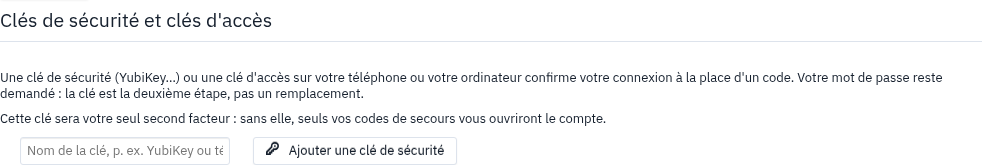
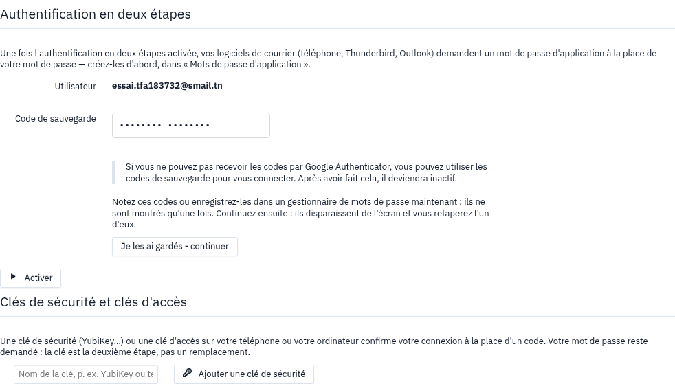

# Guide de l'utilisateur — la validation en deux étapes

La validation en deux étapes protège votre compte même si quelqu'un apprend votre mot de passe : à la
connexion, le webmail demande en plus un code de votre téléphone, ou votre clé de sécurité. Tout se règle
dans **Réglages**, onglet **Authentification en deux étapes**.

## Activer la validation avec une application à codes

**À quoi ça sert :** demander, à chaque connexion, un code à six chiffres que seule votre application
connaît (Google Authenticator, Microsoft Authenticator, FreeOTP…).

1. Installez une application à codes sur votre téléphone.
2. Dans le webmail, ouvrez **Réglages**, puis **Authentification en deux étapes**.
3. Cliquez sur **Créer une nouvelle clé secrète**. Un code QR s'affiche.
4. Dans l'application du téléphone, ajoutez un compte en photographiant le code QR.
5. Cliquez sur **test**, puis saisissez le code que l'application affiche.
6. Notez vos **codes de secours** et gardez-les en lieu sûr (voir plus bas).
7. Cochez **Activer l'authentification en deux étapes**.

**Résultat :** à la prochaine connexion, le webmail demande le code de l'application en plus du mot de
passe. Si votre webmail propose **Mots de passe d'application**, vos logiciels de courrier (téléphone,
Thunderbird, Outlook) en demandent un à la place de votre mot de passe : créez-les d'abord.

## Se connecter avec le code

**À quoi ça sert :** ouvrir sa session quand la validation en deux étapes est active.

1. Sur l'écran de connexion, saisissez votre adresse et votre mot de passe.
2. Dans le champ **Code de vérification ou code de secours**, tapez le code que l'application affiche.
3. Validez.

**Résultat :** vous êtes connecté. Un code ne sert qu'une fois et change toutes les 30 secondes.

Si la connexion est refusée, le webmail rappelle qu'il faut aussi le code, un code de secours ou la clé. Le
même message s'affiche pour tout le monde : il ne dit pas si un compte a la validation en deux étapes.

## Ajouter une clé de sécurité ou une clé d'accès

**À quoi ça sert :** confirmer la connexion en touchant une clé (YubiKey…) ou par l'empreinte de votre
téléphone ou de votre ordinateur, sans taper de code.

1. Ouvrez **Réglages**, puis **Authentification en deux étapes**.
2. Sous **Clés de sécurité et clés d'accès**, donnez un nom à la clé, par exemple « YubiKey » ou
   « téléphone ».
3. Cliquez sur **Ajouter une clé de sécurité**, puis touchez la clé ou confirmez sur l'appareil.

**Résultat :** la clé apparaît dans la liste, avec son nom, sa date d'ajout et sa dernière utilisation.

Si c'est votre première clé et que vous n'avez pas d'application à codes, le webmail vous prévient :

Il vous montre alors vos codes de secours avant d'activer la clé : c'est ce qui vous ouvrira le compte si la
clé n'est pas avec vous.

## Garder ses codes de secours

**À quoi ça sert :** entrer dans votre compte le jour où vous n'avez ni votre téléphone ni votre clé.

1. Quand le webmail affiche vos huit codes de secours, notez-les ou enregistrez-les dans un gestionnaire de
   mots de passe. Ils ne sont montrés qu'une fois.
2. Cliquez sur **Je les ai gardés - continuer**. Les codes disparaissent de l'écran.
3. Le webmail demande **Retapez le code de secours n° … de votre liste** : tapez ce code, puis
   **Confirmer**.

**Résultat :** la clé ou les nouveaux codes deviennent actifs. Tant que vous n'avez pas confirmé, rien ne
change pour votre compte. **Annuler et recommencer** produit une nouvelle liste.

## Se connecter avec une clé de sécurité

**À quoi ça sert :** ouvrir sa session d'un geste, sans taper de code.

1. Sur l'écran de connexion, saisissez votre adresse et votre mot de passe.
2. Cliquez sur **Utiliser une clé de sécurité ou une clé d'accès**.
3. Touchez la clé, ou confirmez sur votre appareil.

**Résultat :** vous êtes connecté. Votre mot de passe reste demandé : la clé est la deuxième étape, pas un
remplacement.

## Se connecter avec un code de secours

**À quoi ça sert :** entrer dans son compte sans son téléphone ni sa clé.

1. Sur l'écran de connexion, saisissez votre adresse et votre mot de passe.
2. Dans le champ **Code de vérification ou code de secours**, tapez un de vos codes de secours.

**Résultat :** vous êtes connecté, et ce code ne servira plus. Le nombre de codes qui restent s'affiche dans
**Codes de secours restants**.

## Régénérer ses codes de secours

**À quoi ça sert :** obtenir une nouvelle liste quand vous avez utilisé presque tous vos codes, ou perdu la
liste.

1. Ouvrez **Réglages**, puis **Authentification en deux étapes**.
2. Cliquez sur **Régénérer les codes de secours**, puis confirmez avec votre code ou votre clé.
3. Gardez la nouvelle liste et confirmez-la comme plus haut.

**Résultat :** huit nouveaux codes. Les anciens restent valables jusqu'à la confirmation des nouveaux.

## Quand la clé est votre seul second facteur

**À quoi ça sert :** ne pas perdre l'accès à votre compte le jour où la clé n'est pas avec vous.

Tant que vous n'avez qu'une clé, sans application à codes, un avertissement reste affiché dans les
réglages :

1. Cliquez sur **Ajouter une application à codes**.
2. Suivez les étapes de « Activer la validation avec une application à codes ».

**Résultat :** vous avez une seconde voie d'accès, et l'avertissement disparaît.

## Retirer une clé

**À quoi ça sert :** ne plus accepter une clé perdue ou remplacée.

1. Ouvrez **Réglages**, puis **Authentification en deux étapes**.
2. À côté de la clé, cliquez sur **Retirer**.
3. Confirmez avec un code, ou avec la clé elle-même.

**Résultat :** la clé ne permet plus de se connecter. Une personne qui aurait volé votre session ne peut pas
retirer vos protections sans votre code ou votre clé.

## Questions fréquentes

**J'ai perdu mon téléphone.**
Connectez-vous avec un code de secours, puis créez une nouvelle clé secrète dans les réglages pour votre
nouveau téléphone.

**Je n'ai plus ni téléphone, ni clé, ni codes de secours.**
Adressez-vous à votre administrateur : il peut, après vérification, remettre à zéro votre validation en
deux étapes.

**Le code est refusé alors que je le tape bien.**
Vérifiez que l'heure de votre téléphone est réglée automatiquement : un code dépend de l'heure. Vérifiez
aussi que vous lisez le bon compte dans l'application.

**Après plusieurs essais, plus rien ne passe.**
Après cinq échecs en quinze minutes, le compte est bloqué un moment, même avec un bon code. Attendez un
quart d'heure.

**Mon téléphone ou Thunderbird ne reçoit plus le courrier.**
Si votre webmail propose **Mots de passe d'application**, ces logiciels en demandent un à la place de votre
mot de passe : créez-en un par appareil. Sinon, adressez-vous à votre administrateur.
